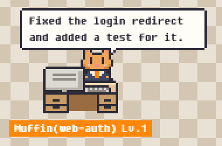
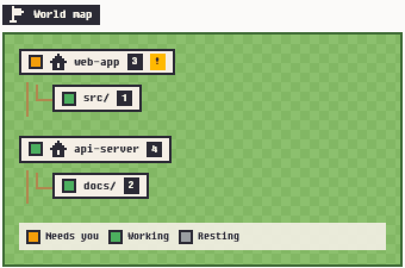
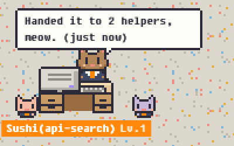
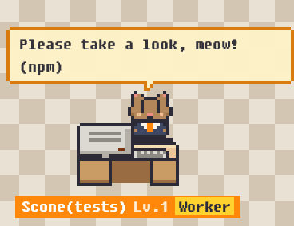
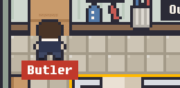
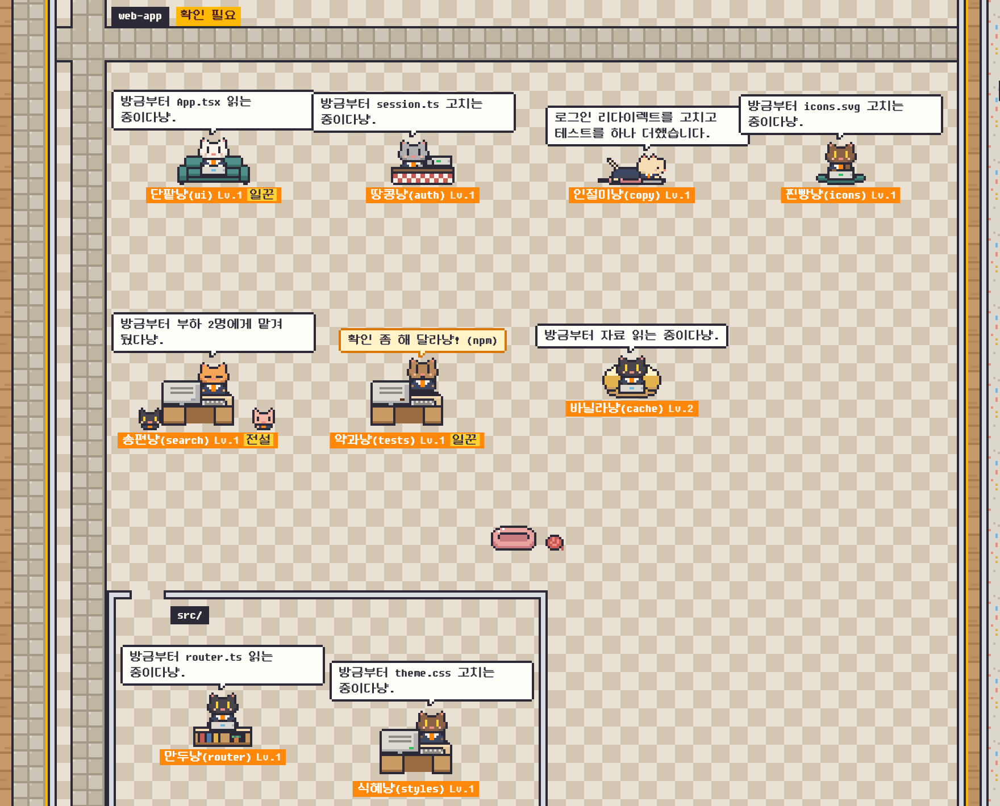

<p align="center">
  
</p>

<h1 align="center">kttn</h1>

<p align="center">あなたのコンピューターの Claude Code セッションを、オフィスのピクセル猫として見せます。</p>

<p align="center">
  <a href="https://github.com/hgwk/kttn/releases"></a>
  <a href="https://www.npmjs.com/package/@hgwk/kttn"></a>
  <a href="LICENSE"></a>
  
</p>

<p align="center"><a href="README.md">English</a> · <a href="README.ko.md">한국어</a> · <b>日本語</b></p>

<p align="center">
  
  <br><sub><a href="https://raw.githubusercontent.com/hgwk/kttn/main/docs/images/full-ja.png">画面全体を見る</a></sub>
</p>

```sh
npx @hgwk/kttn
```

コマンドひとつで、オフィス名を決め、Claude Code にフックをかけ、ログイン時に自動で起動し、ブラウザーで開きます。

kttn は、あなたのコンピューターで動いている Claude Code セッションを、オフィスの
ピクセル猫として見せます。リポジトリごとにオフィス、フォルダーごとに部屋、
セッションごとに机の猫がひとつずつできます。猫はセッションに合わせて読み、直し、
コマンドを動かし、あなたを待ち、居眠りし、退勤します。すべてはあなたの
コンピューターの中にとどまります。Claude Code のフックが短いラベルだけを
`127.0.0.1` の小さなサーバーに送り、画面はそのサーバーが出すページです。
画面は日本語、英語、韓国語に対応しています。

## 機能

| | |
| --- | --- |
|  | **セッションひとつに猫一匹。** 読む、直す、コマンドを動かす、考える、しばらく静かなら居眠り、セッションが終われば退勤。回答プレビューをオンにすると、仕事を終えた猫が何をしたか話します。 |
|  | **オフィスはリポジトリ、部屋はフォルダー。** ワールドマップに猫の数と一緒に並び、地点を押すとその部屋へ移動します。 |
|  | **子猫はサブエージェント。** 仕事が終わるまで机のそばにいます。バックグラウンドで動くものも同じです。 |
|  | **確認が必要。** 権限の確認を待つ猫は点滅し、その部屋とオフィスにも印が付くので、どこからでも分かります。 |
|  | **執事。** 猫を押すと執事が歩いていき、そのセッションのターミナルのタブを前に出します。吹き出しを押すと、そのセッションにメッセージを送れます。 |
| 🔒 | **短いラベルだけ。** プロンプト、ファイルの内容、コマンドの引数、エラーの文言はセッションの外に出ません。[セッションから出ていくもの](#セッションから出ていくもの)を見てください。 |

## 動いている様子

<p align="center">
  
</p>

<p align="center">
  
  
</p>

## クイックスタート

```sh
npx @hgwk/kttn
```

このコマンドひとつで、オフィス名と言語を聞き、Claude Code にフックをかけ、
ログイン時にオフィスが起動するよう登録し(macOS は LaunchAgent、Linux は systemd
ユーザーサービス)、ブラウザーで開きます。何度実行しても大丈夫です。設定はそのままに、
フックと自動起動だけを新しくします。`kttn uninstall` でフックと自動起動を外せます。

kttn は macOS と Linux(arm64、x86-64)で動きます。**Windows には対応していません。**

## セッションから出ていくもの

フックは呼ばれるたびに小さなイベントをひとつ送り、含まれるのは次のものだけです。

- セッション ID、リポジトリ名、その中のフォルダー、リポジトリがホームフォルダーから
  見てどこにあるか(アカウント名の代わりに `~`)
- フックのイベント名とツール名
- 短いラベルひとつ: ファイル名、コマンドの最初のプログラム(`go`、`npm`)、
  Web のホスト、サブエージェントの種類、MCP サーバー名、メッセージを受け取る
  セッション名のどれか
- いくつかのイベントでは一語の理由: `startup`、`rate_limit`、`auto`、モデル名。
  エラーは決まった種類のどれかだけを送り、原文は送りません
- `SessionStart`、`UserPromptSubmit`、`Stop`、`Notification` のときだけ
  (ツールのイベントには付けない): Claude Code のプロセス番号とセッション名。
  ターミナルを閉じたセッションは外し、開いているセッションは席を保つために使います。

プロンプト、ファイルの内容、コマンドの引数、エラーの文言、メッセージの本文は送りません。

**回答プレビュー(初期設定はオフ)。** `kttn init` でオンにすると、`Stop` が
終えたばかりの回答の先頭 300 文字も送って猫が何をしたか話し、机のチェックリストにやることのタイトルも送ります。
サーバーはセッションごとに最後のひとつだけを、メモリとローカルの状態ファイルに持ちます。

## インストール

自分でインストールする場合は、ひとつ選んでください。

- **npm**(`kttn` を PATH に置きます。GitHub Releases からプラットフォーム用の
  バイナリーを取得し、SHA-256 を確認します):

  ```sh
  npm i -g @hgwk/kttn
  ```

  新しい npm は `@hgwk/kttn` のインストールスクリプトを実行しなかったと警告する
  ことがあります。問題ありません。kttn は最初の実行時にバイナリーを取得します。
  インストール時に取得したい場合は `--allow-scripts=@hgwk/kttn` を付けてください。

- **GitHub Releases**: https://github.com/hgwk/kttn/releases から
  `kttn_<version>_<os>_<arch>.tar.gz` を取得し、`SHA256SUMS` で確認して、`kttn` を
  PATH 上のフォルダーに置きます。

- **ソースから**(Go 1.22+、Node 22.12+):

  ```sh
  git clone https://github.com/hgwk/kttn && cd kttn
  npm --prefix web ci && npm --prefix web run build   # 画面をビルドしてバイナリーに入れる
  go build -o ~/.local/bin/kttn ./cmd/kttn             # PATH 上の好きなフォルダー
  ```

そのあと `kttn` を実行するか(クイックスタートと同じ設定)、手作業で行います。

```sh
kttn init    # オフィス名、言語、ポート、回答プレビュー。~/.config/kttn/config.json に保存
kttn serve   # http://127.0.0.1:5886
```

Chrome でアドレスを開いてください。アドレスバーの ⊕ からアプリとしてインストール
すると、専用のウィンドウと Dock アイコンができます。

### Claude Code とつなぐ

フックは `kttn hook` を実行するので、先に kttn をインストールしてください(上記)。
`kttn` が Claude Code から見える `PATH` にある必要があります。そのうえで、次の
**どちらかひとつ**を使ってください。両方使うと、すべてのイベントが二重に届きます。

- **プラグイン**: 使う 24 のイベントにフックを登録します。

  ```text
  /plugin marketplace add hgwk/kttn
  /plugin install kttn@kttn
  ```

- **`kttn install`**: 同じフックを `~/.claude/settings.json`(または
  `$CLAUDE_CONFIG_DIR/settings.json`)の既存のフックの隣に入れ、前のファイルを
  `settings.json.bak` として残します。`kttn uninstall` はそのフックだけを外し、
  ほかはそのままにします。

サーバーが動いていなければ、フックは 300ms であきらめ、セッションはそのまま続きます。
何も出力せず、セッションを止めることもありません。

どちらも `WorktreeCreate` にはフックをかけません。そこにかけたフックは Claude Code
本来のワークツリー作成を置き換えてしまうからです。

## コマンド

| コマンド | すること |
| --- | --- |
| `kttn` または `kttn setup` | まとめて設定: 初回はオフィス名と言語を聞き、Claude Code のフック、自動起動、オフィスを開く。 |
| `kttn init [--yes] [--office-name NAME] [--lang ko\|en\|ja] [--port N] [--preview]` | 設定を聞き(または `--yes` でフラグを使い)、前の答えを既定値にし、使いたいポートがほかに使われていれば別のポートを選び、フックとサーバーが共有するトークンを作ります。 |
| `kttn serve [--port N]` | `127.0.0.1` でオフィスを動かします。 |
| `kttn hook [--url URL] [--source claude] [--timeout 300ms]` | Claude Code のフック。標準入力からフックの内容を読みます。 |
| `kttn install` | プラグインを使わない場合に、Claude Code のユーザー設定へフックを入れます。 |
| `kttn uninstall` | フックを外し、自動起動を止めます。設定とセッションの状態は残ります。 |
| `kttn open` | 画面の鍵を付けてブラウザーでオフィスを開きます。 |
| `kttn version` | バージョンを表示します。 |

設定は `~/.config/kttn/config.json`(権限 600、`KTTN_CONFIG` で移動)にあります。
`KTTN_URL` と `KTTN_TOKEN` はフックのアドレスとトークンを上書きします。セッションは
`~/.local/state/kttn/sessions.json`(`KTTN_STATE` で移動)のおかげで再起動後も
続きます。

画面の言語は、アドレスの `?lang=`、設定、ブラウザーの順に決まり、分からなければ英語です。

## ターミナルのタブ

猫を押すと、執事が歩いていってそのセッションのターミナルのタブを前に出します。
吹き出しを押すと、そのセッションの入力欄にメッセージを入れ、Enter まで押します。

kttn はセッションのプロセスからタブを見つけます: プロセス → tty → その tty の
ターミナルのペイン。次の順に試します。

| ターミナル | 前に出す | メッセージ |
| --- | --- | --- |
| tmux | ウィンドウとペインを選ぶ(外側のアプリはそのまま) | `send-keys` |
| Kaku、WezTerm | `cli activate-pane` のあとアプリを前に | `cli send-text` |
| iTerm2 | AppleScript、セッションの `tty` で | AppleScript `write text` |
| Terminal.app | AppleScript、タブの `tty` で | 非対応(アクセシビリティの権限が必要) |

インストールされていない、または動いていないターミナルは飛ばし、動いていない
ターミナルを新たに起動することはありません。AppleScript は初回にオートメーションの
権限を求めます。tmux を使うには、`kttn serve` の `PATH` に `tmux` が必要です。

メッセージは 2,000 文字までで、制御文字は取り除き、権限の確認を待っている
セッション(文字がその質問への答えになってしまう)や終了したセッションには送りません。
作業中のセッションはメッセージを次の番として受け取ります。メッセージの本文は
ログに残しません。

## 安全

サーバーは `127.0.0.1` でだけ待ち受け、`127.0.0.1` や `localhost` 以外のホスト名
あてのリクエストはすべて拒否して、DNS リバインディングを防ぎます。フックの報告
(`/api/events`)は JSON で、トークンを含み、`Origin` ヘッダーがないものに限るので、
ブラウザーの Web ページがセッションをでっち上げることはできません。画面の操作
(`/api/focus`、`/api/message`)は同じアドレスのページからの JSON だけを受け付けるので、
ほかのサイトがあなたのターミナルに文字を打ち込むことはできません。

セッションの情報とターミナルの操作には**画面の鍵**も必要です。設定ファイル
(権限 600)にだけあるランダムな値です。Origin と Host の確認はほかの Web サイトを
防ぎますが、同じコンピューターのほかのプログラムやほかのユーザーは防げません。
鍵はそれを防ぎます。`kttn` と `kttn open` がオフィスを `/#k=<鍵>` で開くと、
画面はブラウザーに鍵を保存し、アドレスからは消します。鍵のないページは 401 を受け、
`kttn open` を実行するよう案内します。

オフィス自身と、設定の `embed_origins` に書いたページだけが、オフィスを iframe で
表示できます(`frame-ancestors`)。既定値は空のリストです。オフィスを埋め込むページも、iframe のアドレスで
鍵を渡します: `http://127.0.0.1:5886/#k=<screen_key>`。

## 開発

```sh
go vet ./... && go test ./...
npm --prefix web test && npm --prefix web run typecheck
npm --prefix web run dev    # 画面をその場で直しながら開発、/api は kttn serve へ
```

ソースファイルは 300 行以下に保ちます。

## まだのこと

- ターミナルの代わりに Claude Code Channels でメッセージを送ること。Channels は
  リサーチプレビューで、自作のチャンネルは開発用フラグを付けたときだけ有効になるため、
  今はターミナルに入力しています。
- Codex のセッション。同じ形のイベントを送る Codex のフックがあれば、
  `--source codex` でオフィスに一緒に表示されます。

## ライセンス

kttn は MIT ライセンスです([LICENSE](LICENSE))。同梱のフォントは
[THIRD_PARTY_NOTICES.md](THIRD_PARTY_NOTICES.md) にあり、ピクセルアートは
このプロジェクトのために描き下ろしたものです。
