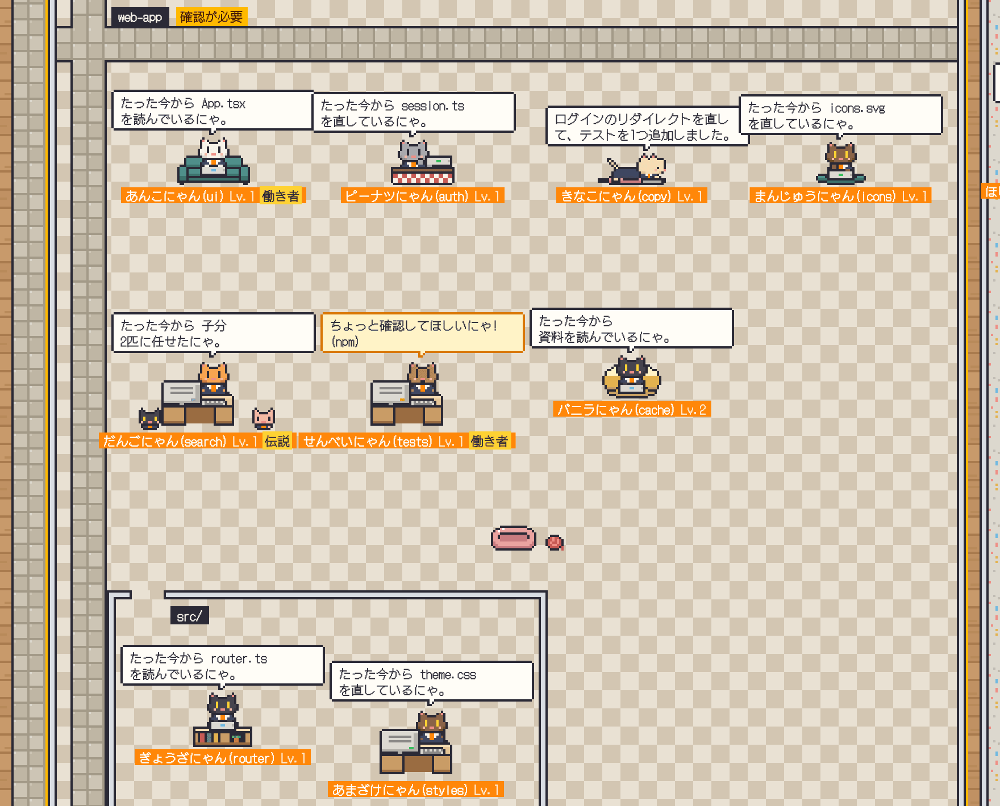
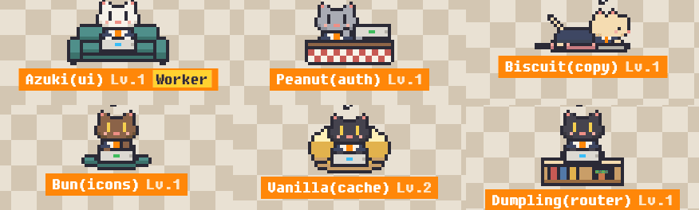
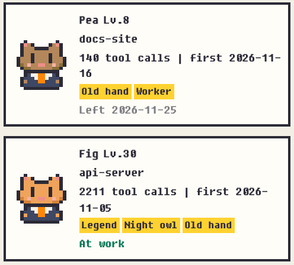
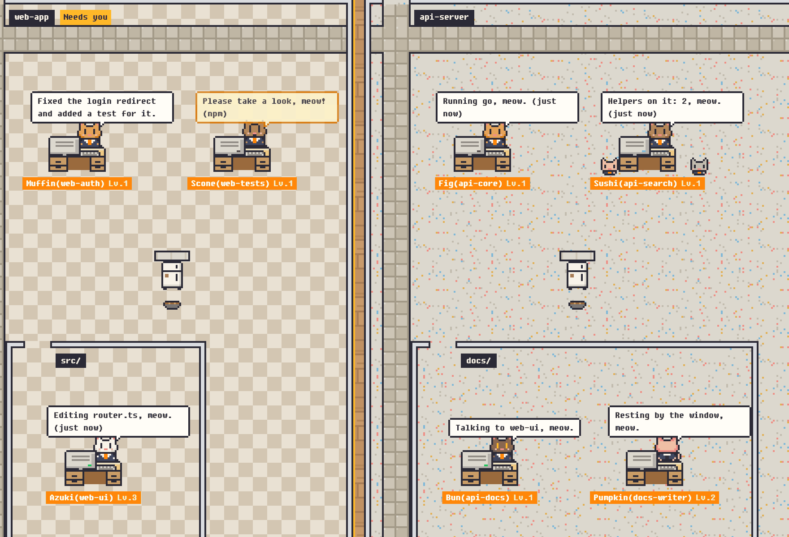
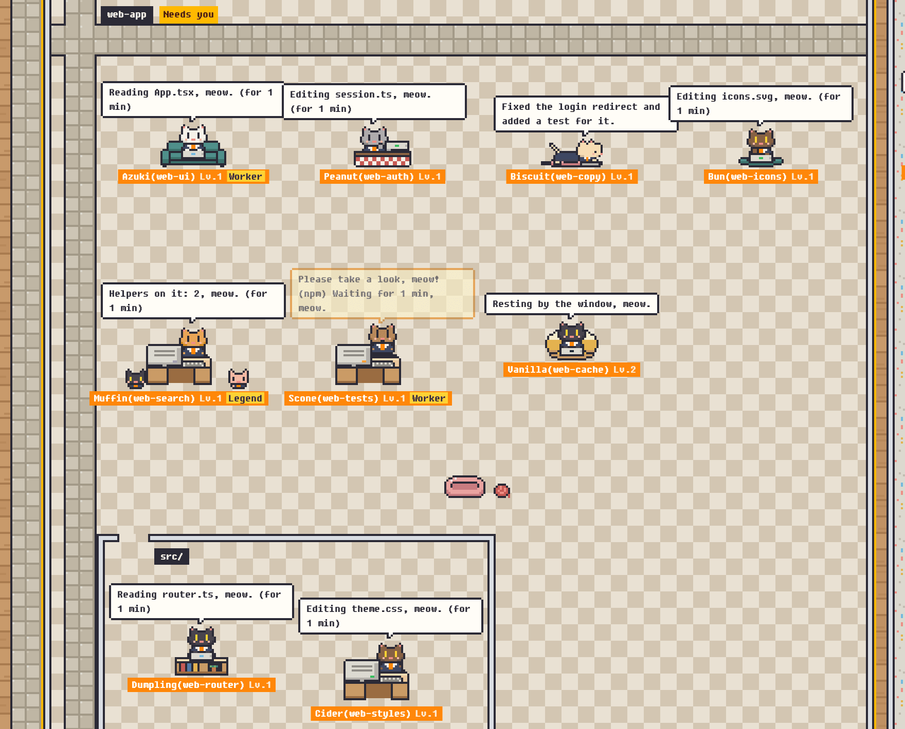

<p align="center">
  
</p>

<h1 align="center">kttn</h1>

<p align="center">あなたのコンピューターの Claude Code セッションを、ピクセル猫として見せます。</p>

<p align="center">
  <a href="https://github.com/hgwk/kttn/releases"></a>
  <a href="https://www.npmjs.com/package/@hgwk/kttn"></a>
  <a href="LICENSE"></a>
  
</p>

<p align="center"><a href="README.md">English</a> · <a href="README.ko.md">한국어</a> · <b>日本語</b></p>

<p align="center">
  
  <br><sub><a href="https://raw.githubusercontent.com/hgwk/kttn/main/docs/images/full-ja.png">画面全体を見る</a></sub>
</p>

kttn は、あなたのコンピューターで動いている Claude Code セッションを、
ピクセル猫として見せます。リポジトリごとにエリア、フォルダーごとに部屋、
セッションごとに机か自由席の猫がひとつずつできます。猫はセッションに合わせて読み、直し、
コマンドを動かし、あなたを待ち、居眠りし、退勤します。すべてはあなたの
コンピューターの中にとどまります。Claude Code のフックが短いラベルだけを
`127.0.0.1` の小さなサーバーに送り、画面はそのサーバーが出すページです。
画面は日本語、英語、韓国語に対応しています。

## クイックスタート

```sh
npx @hgwk/kttn
```

このコマンドひとつで、kttn の名前と言語を聞き、Claude Code にフックをかけ、
ログイン時に kttn が起動するよう登録し(macOS は LaunchAgent、Linux は systemd
ユーザーサービス)、ブラウザーで開きます。何度実行しても大丈夫です。設定はそのままに、
フックと自動起動だけを新しくします。`kttn uninstall` でフックと自動起動を外せます。

kttn は macOS と Linux(arm64、x86-64)で動きます。**Windows には対応していません。**

## 機能

| | |
| --- | --- |
|  | **セッションひとつに猫一匹。** 読む、直す、コマンドを動かす、考える、しばらく静かなら居眠り、セッションが終われば退勤。回答プレビューをオンにすると、仕事を終えた猫が何をしたか話します。 |
|  | **机と自由席。** 机のほかに、座布団でノートパソコン、うつぶせでタブレット、ビーズクッション、ソファ、窓辺、こたつでも働きます。猫ごとに席が決まっています。 |
|  | **エリアはリポジトリ、部屋はフォルダー。** ワールドマップに猫の数と一緒に並び、地点を押すとその部屋へ移動します。 |
|  | **子猫はサブエージェント。** 仕事が終わるまで机のそばにいます。バックグラウンドで動くものも同じです。 |
|  | **確認が必要。** 権限の確認を待つ猫は点滅し、その部屋とエリアにも印が付くので、どこからでも分かります。 |
|  | **執事。** 猫を押すと執事が歩いていき、そのセッションのターミナルのタブを前に出します。吹き出しを押すと、そのセッションにメッセージを送れます。 |
|  | **猫図鑑。** 退勤した猫まで、出会った猫すべてをレベル、称号、ツール数、同時勤務の最高記録と一緒に見せます。[残すもの](#セッションから出ていくもの)を見てください。 |
| 🔒 | **短いラベルだけ。** プロンプト、ファイルの内容、コマンドの引数、エラーの文言はセッションの外に出ません。[セッションから出ていくもの](#セッションから出ていくもの)を見てください。 |

**そのほか**

- **一日の新聞。** その日の猫の名前、ツール数と失敗数、いちばん長い昼寝、猫の絵を PNG で保存。
- **一日のタイムラプス(初期設定はオフ)。** タブが見えているあいだ 10 分ごとに自動で撮影、再生、WebM で保存。
- **季節。** 12 月の雪とツリー、夜明け前の暗めの照明。
- **8 ビット効果音(初期設定はオフ)。**
- **なでなでと PNG 保存。** 執事を猫のそばに立たせてスペースでなでる、キャプチャで kttn 全体を PNG で保存。
- **隠しキー。** あるキーの順番を押すと、猫たちが何かをします。

## 動いている様子

<p align="center">
  
</p>

<p align="center">
  
  
</p>

## セッションから出ていくもの

フックは呼ばれるたびに小さなイベントをひとつ送り、含まれるのは次のものだけです。

- セッション ID、リポジトリ名、その中のフォルダー、リポジトリがホームフォルダーから
  見てどこにあるか(アカウント名の代わりに `~`)
- フックのイベント名とツール名
- 短いラベルひとつ: ファイル名、コマンドの最初のプログラム(`go`、`npm`)、
  Web のホスト、サブエージェントの種類、MCP サーバー名、メッセージを受け取る
  セッション名のどれか
- いくつかのイベントでは一語の理由: `startup`、`rate_limit`、`auto`、モデル名。
  エラーは決まった種類のどれかだけを送り、原文は送りません
- `SessionStart`、`UserPromptSubmit`、`Stop`、`Notification` のときだけ
  (ツールのイベントには付けない): Claude Code のプロセス番号とセッション名。
  ターミナルを閉じたセッションは外し、開いているセッションは席を保つために使います。

プロンプト、ファイルの内容、コマンドの引数、エラーの文言、メッセージの本文は送りません。

**回答プレビュー(初期設定はオフ)。** `kttn init` でオンにすると、`Stop` が
終えたばかりの回答の先頭 300 文字も送って猫が何をしたか話し、机のチェックリストにやることのタイトルも送ります。
サーバーはセッションごとに最後のひとつだけを、メモリとローカルの状態ファイルに持ちます。

**猫の図鑑。** サーバーは見たセッションを退勤したあとも
`~/.local/state/kttn/cats.json`(権限 600、セッションの状態の隣)に残します。
リポジトリ、フォルダー、モデル、セッション名、画面が付けた猫の名前、最初と最後に
見た時刻、使ったツールの数(全体と最後に働いた日、その日に失敗した数)、このコンピューターの時刻で深夜 0 時から 5 時のあいだに
働いたことがあるか(記録が残っているあいだ保持)、そして kttn に同時にいた
セッション数の最高記録とその時刻だけで、全体のツール数はそのセッションが始まってから使ったすべてで、図鑑が最初に見る前の分
(初期化の直後も)も含み、その日のツール数はその日に見た分だけを数えます。
ほかのセッションの内容は入りません。90 日以内に
見た最近の 1,000 匹までを残し、画面の **図鑑リセット**(5 秒以内に 2 回押す)ですべて消せます。

**一日の kttn 新聞。** 新聞ボタンでその日の新聞を描き、保存を押すと PNG として
このコンピューターにダウンロードします。日付、猫の名前(自分で付けた名前を含む)、
その日のツールの数と失敗の数、いちばん長い昼寝、出勤した猫の数、最高同時勤務、
猫の絵が入り、リポジトリ、フォルダー、セッションの名前は入りません。

**一日のタイムラプス(初期設定はオフ)。** 自動記録をオンにすると、タブが見えている
あいだ 10 分ごとに kttn を撮ります。画面に見えているとおりに撮るので、リポジトリ名、
フォルダー名、セッション名と、回答プレビューがオンなら吹き出しの最後の回答の文も
入ります。写真はこのブラウザーにだけ最大 2 日(1 日 160 枚)残り、サーバーには
送りません。保存した動画にも入るので、共有する前に確かめてください。タイムラプスの
ウィンドウの **記録の削除**(5 秒以内に 2 回押す)で消せます。

## インストール

自分でインストールする場合は、ひとつ選んでください。

- **npm**(`kttn` を PATH に置きます。GitHub Releases からプラットフォーム用の
  バイナリーを取得し、SHA-256 を確認します):

  ```sh
  npm i -g @hgwk/kttn
  ```

  新しい npm は `@hgwk/kttn` のインストールスクリプトを実行しなかったと警告する
  ことがあります。問題ありません。kttn は最初の実行時にバイナリーを取得します。
  インストール時に取得したい場合は `--allow-scripts=@hgwk/kttn` を付けてください。

  設定はバイナリーを `~/.local/bin/kttn` にコピーし、フックと自動起動が npm の更新で
  切れないようにします。`npm update -g @hgwk/kttn` のあとは `kttn` をもう一度実行して
  新しいバージョンに切り替えてください。

- **GitHub Releases**: https://github.com/hgwk/kttn/releases から
  `kttn_<version>_<os>_<arch>.tar.gz` を取得し、`SHA256SUMS` で確認して、`kttn` を
  PATH 上のフォルダーに置きます。

- **ソースから**(Go 1.22+、Node 22.12+):

  ```sh
  git clone https://github.com/hgwk/kttn && cd kttn
  npm --prefix web ci && npm --prefix web run build   # 画面をビルドしてバイナリーに入れる
  go build -o ~/.local/bin/kttn ./cmd/kttn             # PATH 上の好きなフォルダー
  ```

そのあと `kttn` を実行するか(クイックスタートと同じ設定)、手作業で行います。

```sh
kttn init    # kttn の名前、言語、ポート、回答プレビュー。~/.config/kttn/config.json に保存
kttn serve   # http://127.0.0.1:5886
```

Chrome でアドレスを開いてください。アドレスバーの ⊕ からアプリとしてインストール
すると、専用のウィンドウと Dock アイコンができます。

### Claude Code とつなぐ

フックは `kttn hook` を実行するので、先に kttn をインストールしてください(上記)。
`kttn` が Claude Code から見える `PATH` にある必要があります。そのうえで、次の
**どちらかひとつ**を使ってください。両方使うと、すべてのイベントが二重に届きます。

- **プラグイン**: 使う 24 のイベントにフックを登録します。

  ```text
  /plugin marketplace add hgwk/kttn
  /plugin install kttn@kttn
  ```

  プラグインのフックは設定ファイルの場所を指定できないので、設定を別の場所
  (`XDG_CONFIG_HOME` や `KTTN_CONFIG`)に置く場合は、プラグインではなく `kttn` か
  `kttn install` で登録してください。

- **`kttn install`**: 同じフックを `~/.claude/settings.json`(または
  `$CLAUDE_CONFIG_DIR/settings.json`)の既存のフックの隣に入れ、前のファイルを
  `settings.json.bak` として残します。`kttn uninstall` はそのフックだけを外し、
  ほかはそのままにします。

サーバーが動いていなければ、フックは 300ms であきらめ、セッションはそのまま続きます。
何も出力せず、セッションを止めることもありません。

どちらも `WorktreeCreate` にはフックをかけません。そこにかけたフックは Claude Code
本来のワークツリー作成を置き換えてしまうからです。

## コマンド

| コマンド | すること |
| --- | --- |
| `kttn` または `kttn setup` | まとめて設定: 初回は kttn の名前と言語を聞き、Claude Code のフック、自動起動、kttn を開く。 |
| `kttn init [--yes] [--name NAME] [--lang ko\|en\|ja] [--port N] [--preview] [--messages]` | 設定を聞き(または `--yes` でフラグを使い)、前の答えを既定値にし、使いたいポートがほかに使われていれば別のポートを選び、フックとサーバーが共有するトークンを作ります。 |
| `kttn serve [--port N]` | `127.0.0.1` で kttn を動かします。 |
| `kttn hook [--config FILE] [--url URL] [--source claude] [--timeout 300ms]` | Claude Code のフック。標準入力からフックの内容を読みます。設定時に書いた設定ファイルを `--config` で固定します。 |
| `kttn install` | プラグインを使わない場合に、Claude Code のユーザー設定へフックを入れます。 |
| `kttn uninstall` | フックを外し、自動起動を止めます。設定とセッションの状態は残ります。 |
| `kttn open` | 画面の鍵を付けてブラウザーで kttn を開きます。 |
| `kttn version` | バージョンを表示します。 |

設定は `~/.config/kttn/config.json`(権限 600、`KTTN_CONFIG` で移動)にあります。
`KTTN_URL` と `KTTN_TOKEN` はフックのアドレスとトークンを上書きします。セッションは
`~/.local/state/kttn/sessions.json`(`KTTN_STATE` で移動)のおかげで再起動後も
続きます。`XDG_CONFIG_HOME` と `XDG_STATE_HOME` にも従います。設定時にフックと
自動起動のサービスをこれらのファイルに固定するので、場所を移したら `kttn` を
もう一度実行してください。

画面の言語は、アドレスの `?lang=`、設定、ブラウザーの順に決まり、分からなければ英語です。

## ターミナルのタブ

猫を押すと、執事が歩いていってそのセッションのターミナルのタブを前に出します。
吹き出しを押すと、そのセッションの入力欄にメッセージを入れ、Enter まで押します。
**メッセージ送信は初期設定ではオフです。** 設定時に一度聞かれ、`kttn init`
(または `kttn init --yes --messages`)でオンにすると、kttn を再起動してすぐに反映します。オフのあいだサーバーは
403 で拒否し、吹き出しはオンにする方法だけを案内します。

kttn はセッションのプロセスからタブを見つけます: プロセス → tty → その tty の
ターミナルのペイン。次の順に試します。

| ターミナル | 前に出す | メッセージ |
| --- | --- | --- |
| tmux | ウィンドウとペインを選ぶ(外側のアプリはそのまま) | `paste-buffer -p`(ブラケットペースト) |
| Kaku、WezTerm | `cli activate-pane` のあとアプリを前に | `cli send-text` |
| iTerm2 | AppleScript、セッションの `tty` で | AppleScript `write text`(改行はスペースに) |
| Terminal.app | AppleScript、タブの `tty` で | 非対応(アクセシビリティの権限が必要) |

インストールされていない、または動いていないターミナルは飛ばし、動いていない
ターミナルを新たに起動することはありません。AppleScript は初回にオートメーションの
権限を求めます。自動起動のサービスは `PATH` に `/opt/homebrew/bin`、
`/usr/local/bin`、設定時に `tmux` が見つかったフォルダーを入れて動くので、
Homebrew・MacPorts・nix の `tmux` も見つかります。

メッセージは 2,000 文字までで、制御文字は取り除き、権限の確認を待っている
セッション(文字がその質問への答えになってしまう)や終了したセッションには送りません。
作業中のセッションはメッセージを次の番として受け取ります。メッセージの本文は
ログに残しません。

## 安全

サーバーは `127.0.0.1` でだけ待ち受け、`127.0.0.1` や `localhost` 以外のホスト名
あてのリクエストはすべて拒否して、DNS リバインディングを防ぎます。フックの報告
(`/api/events`)は JSON で、トークンを含み、`Origin` ヘッダーがないものに限るので、
ブラウザーの Web ページがセッションをでっち上げることはできません。画面の操作
(`/api/focus`、`/api/message`)は同じアドレスのページからの JSON だけを受け付けるので、
ほかのサイトがあなたのターミナルに文字を打ち込むことはできません。

セッションの情報とターミナルの操作には**画面の鍵**も必要です。設定ファイル
(権限 600)にだけあるランダムな値です。Origin と Host の確認はほかの Web サイトを
防ぎますが、同じコンピューターのほかのプログラムやほかのユーザーは防げません。
鍵はそれを防ぎます。`kttn` と `kttn open` が kttn を `/#k=<鍵>` で開くと、
画面はブラウザーに鍵を保存し、アドレスからは消します。鍵のないページは 401 を受け、
`kttn open` を実行するよう案内します。

kttn 自身と、設定の `embed_origins` に書いたページだけが、kttn を iframe で
表示できます(`frame-ancestors`)。既定値は空のリストです。kttn を埋め込むページも、iframe のアドレスで
鍵を渡します: `http://127.0.0.1:5886/#k=<screen_key>`。

**共用のコンピューター:** ほかの人もログインするコンピューターでは、kttn が
起動する前にほかのユーザーがそのポートを先に取ることができ、そうなるとフックの
トークンと画面の鍵がその人のサーバーに送られます。kttn は同じコンピューターの
ほかのユーザーからは守れません。

## 開発

```sh
go vet ./... && go test ./...
npm --prefix web test && npm --prefix web run typecheck
npm --prefix web run dev    # 画面をその場で直しながら開発、/api は kttn serve へ
```

ソースファイルは 300 行以下に保ちます。

`v*` タグを push する前に、そのコミットをきれいに `git archive` した場所で確認します。

1. `cmd/kttn/install.go`、`package.json`、`plugin/.claude-plugin/plugin.json`、
   `.claude-plugin/marketplace.json` のバージョンがそろっている。
2. `go vet ./...` のあと `go test ./... -count=1 -race` を 3 回。リリースの
   ワークフローと同じコマンドで、1 回だけだと競合状態を運よく見逃すことがあります。
3. `npm --prefix web ci` のあと `test`、`typecheck`、`build`。
4. `scripts/e2e-install.sh local` を `KTTN_E2E_CLAUDE=0` で 1 回、PATH に
   `claude` がある状態で 1 回。
5. スクリプトは npm の最新版と次の版のどちらでも PASS すること。新しい動作を見る検査は
   `since <次の版>` で囲み、npm の最新版を相手にも `scripts/e2e-install.sh` を回す。
6. リリースが出たあと、npm を相手に `scripts/e2e-install.sh`。

## まだのこと

- ターミナルの代わりに Claude Code Channels でメッセージを送ること。Channels は
  リサーチプレビューで、自作のチャンネルは開発用フラグを付けたときだけ有効になるため、
  今はターミナルに入力しています。
- 共用のコンピューターでほかのユーザーから守ること: サーバーが自分を証明する
  (トークンで署名したチャレンジ)か、ポートの代わりに Unix ソケットを使う。
- Codex のセッション。同じ形のイベントを送る Codex のフックがあれば、
  `--source codex` で kttn に一緒に表示されます。

## ライセンス

kttn は MIT ライセンスです([LICENSE](LICENSE))。同梱のフォントは
[THIRD_PARTY_NOTICES.md](THIRD_PARTY_NOTICES.md) にあり、ピクセルアートは
このプロジェクトのために描き下ろしたものです。
