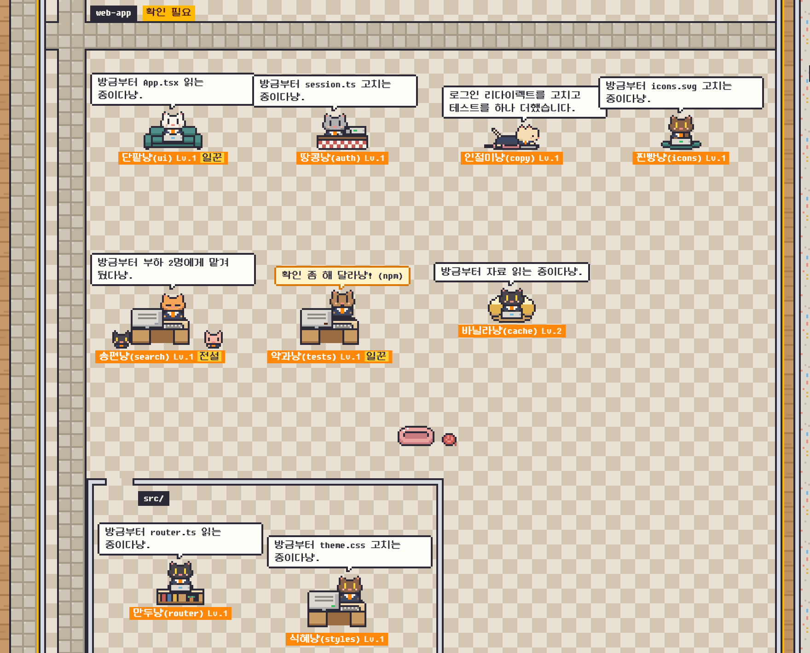
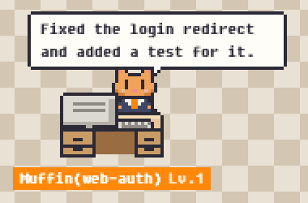
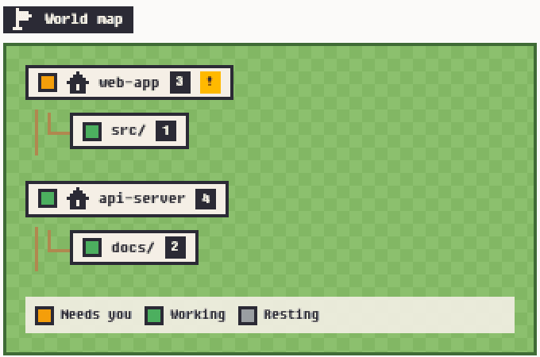
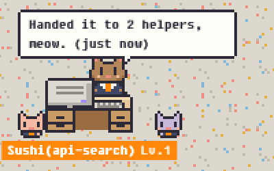
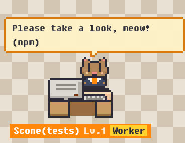
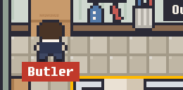
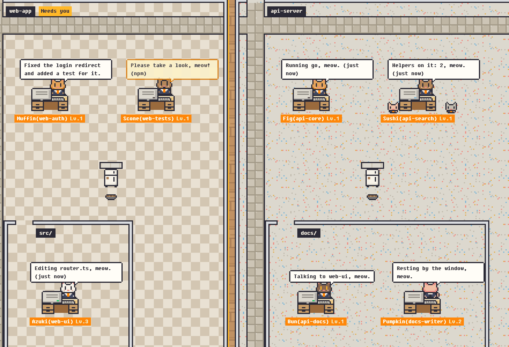
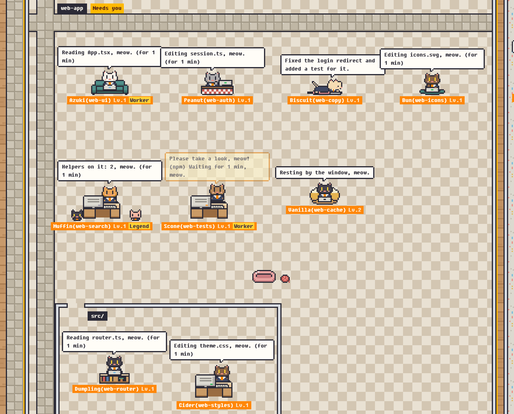
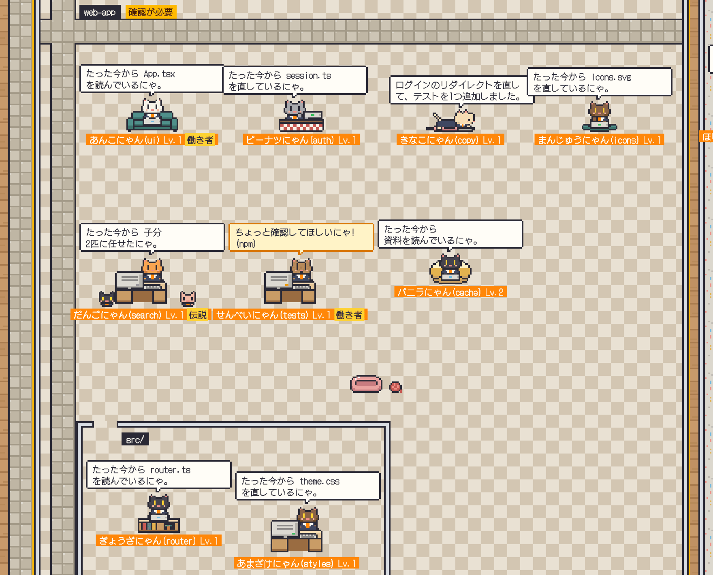

<p align="center">
  
</p>

<h1 align="center">kttn</h1>

<p align="center">내 컴퓨터의 Claude Code 세션을 사무실의 픽셀 고양이로 보여 줍니다.</p>

<p align="center">
  <a href="https://github.com/hgwk/kttn/releases"></a>
  <a href="https://www.npmjs.com/package/@hgwk/kttn"></a>
  <a href="LICENSE"></a>
  
</p>

<p align="center"><a href="README.md">English</a> · <b>한국어</b> · <a href="README.ja.md">日本語</a></p>

<p align="center">
  
  <br><sub><a href="https://raw.githubusercontent.com/hgwk/kttn/main/docs/images/full-ko.png">전체 화면 보기</a></sub>
</p>

```sh
npx @hgwk/kttn
```

명령 하나로 사무실 이름을 정하고, Claude Code에 훅을 걸고, 로그인할 때 자동으로 띄우고, 브라우저로 엽니다.

kttn은 내 컴퓨터에서 돌고 있는 Claude Code 세션을 사무실의 픽셀 고양이로
보여 줍니다. 저장소마다 사무실이, 폴더마다 방이, 세션마다 책상에 앉은 고양이가
하나씩 생깁니다. 고양이는 세션을 따라 읽고, 고치고, 명령을 돌리고, 사람을
기다리고, 졸고, 퇴근합니다. 모든 것이 내 컴퓨터 안에 머뭅니다. Claude Code 훅이
짧은 표시만 `127.0.0.1`의 작은 서버로 보내고, 화면은 그 서버가 내주는 페이지입니다.
화면은 한국어, 영어, 일본어를 지원합니다.

## 기능

| | |
| --- | --- |
|  | **세션 하나에 고양이 하나.** 읽고, 고치고, 명령을 돌리고, 생각하고, 한동안 조용하면 졸고, 세션이 끝나면 퇴근합니다. 답변 미리보기를 켜면 일을 마친 고양이가 무엇을 했는지 말합니다. |
|  | **사무실은 저장소, 방은 폴더.** 월드맵에 냥이 수와 함께 나오고, 지점을 누르면 그 방으로 갑니다. |
|  | **새끼 고양이는 하위 에이전트.** 일이 끝날 때까지 책상 옆에 서 있습니다. 백그라운드로 띄운 것도 마찬가지입니다. |
|  | **확인 필요.** 권한 확인을 기다리는 고양이는 깜빡이고, 그 방과 사무실도 함께 표시돼 어디서든 보입니다. |
|  | **집사.** 고양이를 누르면 집사가 걸어가 그 세션의 터미널 탭을 앞으로 띄웁니다. 말풍선을 누르면 그 세션에 메시지를 보냅니다. |
| 🔒 | **짧은 표시만.** 프롬프트, 파일 내용, 명령 인자, 오류 문구는 세션 밖으로 나가지 않습니다. [세션에서 나가는 것](#세션에서-나가는-것)을 보세요. |

## 움직이는 모습

<p align="center">
  
</p>

<p align="center">
  
  
</p>

## 빠른 시작

```sh
npx @hgwk/kttn
```

이 명령 하나가 사무실 이름과 언어를 묻고, Claude Code에 훅을 걸고, 로그인할 때
사무실이 뜨도록 등록하고(macOS는 LaunchAgent, Linux는 systemd 사용자 서비스),
브라우저로 엽니다. 언제든 다시 실행해도 됩니다. 설정은 그대로 두고 훅과 자동 시작만
새로 고칩니다. `kttn uninstall`은 훅과 자동 시작을 다시 뺍니다.

kttn은 macOS와 Linux(arm64, x86-64)에서 돕니다. **Windows는 지원하지 않습니다.**

## 세션에서 나가는 것

훅은 호출될 때마다 작은 이벤트 하나를 보내며, 담기는 것은 아래뿐입니다.

- 세션 ID, 저장소 이름, 그 안의 폴더, 저장소가 홈 폴더 기준 어디에 있는지
  (계정 이름 대신 `~`)
- 훅 이벤트 이름과 도구 이름
- 짧은 표시 하나: 파일 이름, 명령의 첫 프로그램(`go`, `npm`), 웹 호스트,
  하위 에이전트 종류, MCP 서버 이름, 메시지를 받는 세션 이름 중 하나
- 몇몇 이벤트의 한 단어 이유: `startup`, `rate_limit`, `auto`, 모델 이름. 오류는
  정해진 종류 중 하나로만 보내고 원문은 보내지 않습니다
- `SessionStart`, `UserPromptSubmit`, `Stop`, `Notification`일 때만(도구
  이벤트에는 붙이지 않음): Claude Code 프로세스 번호와 세션 이름. 터미널을 닫은
  세션은 빠지고 열려 있는 세션은 자리를 지키게 하는 데 씁니다.

프롬프트, 파일 내용, 명령 인자, 오류 문구, 메시지 본문은 보내지 않습니다.

**답변 미리보기(기본 꺼짐).** `kttn init`에서 켜면 `Stop`이 방금 끝낸 답변의 앞
300자도 함께 보내 고양이가 무엇을 했는지 말하고, 책상 체크리스트에 할 일 제목도 보냅니다. 서버는 세션마다 마지막
하나만 메모리와 로컬 상태 파일에 들고 있습니다.

**고양이 도감.** 서버는 본 세션을 퇴근한 뒤에도 `~/.local/state/kttn/cats.json`
(권한 600, 세션 상태 옆)에 남깁니다. 저장소, 폴더, 모델, 세션 이름, 화면이 붙인
고양이 이름, 처음과 마지막으로 본 때, 쓴 도구 수(전체와 마지막으로 일한 날, 그날
실패한 수), 이 컴퓨터 시각으로 자정부터 새벽
5시 사이에 일한 적이 있는지(기록이 남아 있는 동안 유지), 그리고 사무실에 동시에 있던
세션 수의 최고 기록과 그 시각뿐이고 전체 도구 수는 그 세션이 시작된 뒤 쓴 전부이고 도감이 처음 보기 전에 쓴 것(초기화 직후
포함)도 들어가며, 하루 도구 수는 그날 본 것만 셉니다. 그 밖의 세션 내용은
없습니다. 90일 안에 본 최근 1,000마리까지만 두고, 화면의 **도감 초기화**(5초 안에 두 번 누름)로
모두 지울 수 있습니다.

**하루 사무실 신문.** 신문 버튼을 누르면 그날의 신문을 그리고, 저장을 누르면 PNG로 내
컴퓨터에 내려받습니다. 날짜, 고양이 이름(직접 붙인 이름 포함), 그날의 도구 수와 실패 수,
가장 오래 잔 낮잠, 출근한 고양이 수, 최고 동시 근무, 고양이 그림이 들어가고 저장소,
폴더, 세션 이름은 들어가지 않습니다.

**하루 타임랩스(기본 꺼짐).** 자동 기록을 켜면 탭이 보이는 동안 10분마다 사무실을
찍습니다. 화면에 보이는 그대로 찍히므로 저장소, 폴더, 세션 이름과, 답변 미리보기를
켰다면 말풍선의 마지막 답변 글도 들어갑니다. 사진은 이 브라우저에만 최대 이틀(하루
160장) 남고 서버로는 보내지 않습니다. 저장한 영상에도 들어가니 공유하기 전에
확인하세요. 타임랩스 창의 **기록 삭제**(5초 안에 두 번 누름)로 지울 수 있습니다.

## 설치

직접 설치하려면 하나를 고르세요.

- **npm** (`kttn`을 PATH에 둡니다. GitHub Releases에서 내 플랫폼용 바이너리를
  받아 SHA-256을 확인합니다):

  ```sh
  npm i -g @hgwk/kttn
  ```

  새 npm은 `@hgwk/kttn`의 설치 스크립트를 실행하지 않았다고 경고할 수 있습니다.
  괜찮습니다. kttn은 처음 실행할 때 바이너리를 받습니다. 설치할 때 바로 받으려면
  `--allow-scripts=@hgwk/kttn`을 붙이세요.

  설정은 바이너리를 `~/.local/bin/kttn`으로 복사해 훅과 자동 시작이 npm 업데이트에도
  끊기지 않게 합니다. `npm update -g @hgwk/kttn` 뒤에는 `kttn`을 한 번 더 실행해
  새 버전으로 바꾸세요.

- **GitHub Releases**: https://github.com/hgwk/kttn/releases 에서
  `kttn_<version>_<os>_<arch>.tar.gz`를 받아 `SHA256SUMS`로 확인하고, `kttn`을
  PATH에 있는 폴더에 둡니다.

- **소스에서** (Go 1.22+, Node 22.12+):

  ```sh
  git clone https://github.com/hgwk/kttn && cd kttn
  npm --prefix web ci && npm --prefix web run build   # 화면을 빌드해 바이너리에 넣는다
  go build -o ~/.local/bin/kttn ./cmd/kttn             # PATH에 있는 아무 폴더
  ```

그다음 `kttn`을 실행하거나(빠른 시작과 같은 설정), 손으로 합니다.

```sh
kttn init    # 사무실 이름, 언어, 포트, 답변 미리보기. ~/.config/kttn/config.json에 저장
kttn serve   # http://127.0.0.1:5886
```

Chrome에서 주소를 여세요. 주소창의 ⊕로 앱처럼 설치하면 따로 창과 Dock 아이콘이
생깁니다.

### Claude Code 연결

훅은 `kttn hook`을 실행하므로 먼저 kttn을 설치하세요(위). `kttn`이 Claude Code가
보는 `PATH`에 있어야 합니다. 그다음 아래 둘 중 **하나만** 쓰세요. 둘 다 쓰면 모든
이벤트가 두 번씩 갑니다.

- **플러그인**: 쓰는 이벤트 24개에 훅을 등록합니다.

  ```text
  /plugin marketplace add hgwk/kttn
  /plugin install kttn@kttn
  ```

  플러그인 훅은 설정 파일 위치를 적을 수 없으므로, 설정을 다른 곳(`XDG_CONFIG_HOME`이나
  `KTTN_CONFIG`)에 둔다면 플러그인 대신 `kttn`이나 `kttn install`로 등록하세요.

- **`kttn install`**: 같은 훅을 `~/.claude/settings.json`(또는
  `$CLAUDE_CONFIG_DIR/settings.json`)에 이미 있는 훅 옆에 넣고, 이전 파일을
  `settings.json.bak`으로 남깁니다. `kttn uninstall`은 그 훅만 빼고 나머지는 그대로
  둡니다.

서버가 꺼져 있으면 훅은 300ms 뒤 포기하고 세션은 계속 갑니다. 아무것도 출력하지
않고 세션을 막지도 않습니다.

어느 쪽도 `WorktreeCreate`에는 걸지 않습니다. 거기 건 훅은 Claude Code의 기본
작업 공간 생성을 대신하기 때문입니다.

## 명령

| 명령 | 하는 일 |
| --- | --- |
| `kttn` 또는 `kttn setup` | 한 번에 설정: 처음이면 사무실 이름과 언어를 묻고, Claude Code 훅, 자동 시작, 사무실 열기. |
| `kttn init [--yes] [--office-name NAME] [--lang ko\|en\|ja] [--port N] [--preview] [--messages]` | 설정을 묻고(또는 `--yes`로 플래그를 받고), 이전 답을 기본값으로 두고, 원하는 포트를 다른 프로그램이 쓰면 다른 포트를 고르고, 훅과 서버가 함께 쓰는 토큰을 만듭니다. |
| `kttn serve [--port N]` | `127.0.0.1`에서 사무실을 띄웁니다. |
| `kttn hook [--config FILE] [--url URL] [--source claude] [--timeout 300ms]` | Claude Code 훅. 표준 입력으로 훅 내용을 받습니다. 설정이 쓴 설정 파일을 `--config`로 고정합니다. |
| `kttn install` | 플러그인 없이 쓸 때 Claude Code 사용자 설정에 훅을 넣습니다. |
| `kttn uninstall` | 훅을 빼고 자동 시작을 멈춥니다. 설정과 세션 상태는 남습니다. |
| `kttn open` | 화면 열쇠를 붙여 브라우저로 사무실을 엽니다. |
| `kttn version` | 버전을 출력합니다. |

설정은 `~/.config/kttn/config.json`(권한 600, `KTTN_CONFIG`로 옮김)에 있습니다.
`KTTN_URL`과 `KTTN_TOKEN`은 훅의 주소와 토큰을 덮어씁니다. 세션은
`~/.local/state/kttn/sessions.json`(`KTTN_STATE`로 옮김) 덕분에 재시작해도
이어집니다. `XDG_CONFIG_HOME`과 `XDG_STATE_HOME`도 따릅니다. 설정이 훅과 자동 시작
서비스를 이 파일들에 고정하므로, 위치를 옮긴 뒤에는 `kttn`을 다시 실행하세요.

화면 언어는 주소의 `?lang=`, 설정, 브라우저 순서로 정하고, 모르면 영어입니다.

## 터미널 탭

고양이를 누르면 집사가 걸어가 그 세션의 터미널 탭을 앞으로 띄웁니다. 말풍선을
누르면 그 세션 입력란에 메시지를 넣고 Enter까지 눌러 줍니다. **메시지 보내기는
기본으로 꺼져 있습니다.** 설정이 한 번 묻고, `kttn init`(또는 `kttn init --yes
--messages`)으로 켜면 사무실을 다시 띄워 바로 적용합니다. 꺼져 있으면 서버가 403으로 거절하고 말풍선은 켜는 방법만
알려 줍니다.

kttn은 세션의 프로세스로 탭을 찾습니다: 프로세스 → tty → 그 tty의 터미널 창.
아래 순서로 시도합니다.

| 터미널 | 앞으로 띄우기 | 메시지 |
| --- | --- | --- |
| tmux | 창과 패널을 고름(바깥 앱은 그대로) | `paste-buffer -p`(붙여넣기 구간) |
| Kaku, WezTerm | `cli activate-pane` 뒤 앱을 앞으로 | `cli send-text` |
| iTerm2 | AppleScript, 세션의 `tty`로 | AppleScript `write text`(줄바꿈은 공백으로) |
| Terminal.app | AppleScript, 탭의 `tty`로 | 지원 안 함(손쉬운 사용 권한 필요) |

설치되지 않았거나 꺼진 터미널은 건너뛰고, 꺼진 터미널을 새로 띄우지 않습니다.
AppleScript는 처음에 자동화 권한을 묻습니다. 자동 시작 서비스는 `PATH`에
`/opt/homebrew/bin`, `/usr/local/bin`, 그리고 설정 때 `tmux`를 찾은 폴더를 넣어 돌므로
Homebrew, MacPorts, nix로 설치한 `tmux`도 찾습니다.

메시지는 2,000자까지이고, 제어 문자는 지우며, 권한 확인을 기다리는 세션(글이 그
질문의 답이 됨)이나 끝난 세션에는 보내지 않습니다. 일하는 중인 세션은 메시지를
다음 차례로 받습니다. 메시지 본문은 로그에 남기지 않습니다.

## 안전

서버는 `127.0.0.1`에서만 듣고, `127.0.0.1`이나 `localhost`가 아닌 호스트 이름으로
온 요청은 모두 거절해 DNS 재바인딩을 막습니다. 훅 보고(`/api/events`)는 JSON이어야
하고, 토큰을 담아야 하고, `Origin` 헤더가 없어야 하므로 브라우저의 웹 페이지가
세션을 꾸며 낼 수 없습니다. 화면 동작(`/api/focus`, `/api/message`)은 같은 주소의
페이지에서 온 JSON만 받으므로 다른 사이트가 내 터미널에 글을 칠 수 없습니다.

세션 정보와 터미널 동작에는 **화면 열쇠**도 필요합니다. 설정 파일(권한 600)에만
있는 무작위 값입니다. Origin·Host 검사는 다른 웹 사이트를 막지만 같은 컴퓨터의
다른 프로그램이나 다른 사용자는 막지 못하는데, 열쇠는 막습니다. `kttn`과
`kttn open`이 사무실을 `/#k=<열쇠>`로 열면 화면이 브라우저에 열쇠를 넣어 두고
주소에서는 지웁니다. 열쇠가 없는 페이지는 401을 받고 `kttn open`을 실행하라고
안내합니다.

사무실 자신과 설정의 `embed_origins`에 적은 페이지만 사무실을 iframe으로 띄울 수
있습니다(`frame-ancestors`). 기본값은 빈 목록입니다. 사무실을 넣는 페이지도 iframe 주소로
열쇠를 넘깁니다: `http://127.0.0.1:5886/#k=<screen_key>`.

**여러 사람이 쓰는 컴퓨터:** 다른 사람도 로그인하는 컴퓨터에서는 내 사무실이 뜨기
전에 다른 사용자가 그 포트를 먼저 잡을 수 있고, 그러면 훅 토큰과 화면 열쇠가 그
사람의 서버로 갑니다. kttn은 같은 컴퓨터의 다른 사용자를 막지 못합니다.

## 개발

```sh
go vet ./... && go test ./...
npm --prefix web test && npm --prefix web run typecheck
npm --prefix web run dev    # 화면을 바로 고쳐 보며 개발, /api는 kttn serve로 넘김
```

소스 파일은 300줄 이하로 유지합니다.

`v*` 태그를 올리기 전에, 그 커밋을 깨끗하게 `git archive`한 곳에서 확인합니다.

1. `cmd/kttn/install.go`, `package.json`, `plugin/.claude-plugin/plugin.json`,
   `.claude-plugin/marketplace.json`의 버전이 같습니다.
2. `go vet ./...` 다음 `go test ./... -count=1 -race`를 세 번 돌립니다. 릴리스
   워크플로가 쓰는 명령 그대로이고, 한 번은 운 좋게 경쟁 상태를 지나칠 수 있습니다.
3. `npm --prefix web ci` 다음 `test`, `typecheck`, `build`.
4. `scripts/e2e-install.sh local`을 `KTTN_E2E_CLAUDE=0`으로 한 번, PATH에
   `claude`가 있는 상태로 한 번.
5. 릴리스가 나온 뒤 npm 대상으로 `scripts/e2e-install.sh`.

## 아직

- 터미널 대신 Claude Code Channels로 메시지 보내기. Channels는 연구 미리보기이고
  직접 만든 채널은 개발용 플래그를 붙여야만 켜져서, 지금은 터미널에 입력합니다.
- 여러 사람이 쓰는 컴퓨터에서 다른 사용자 막기: 서버가 스스로를 증명하기(토큰으로
  서명한 챌린지), 또는 포트 대신 Unix 소켓.
- Codex 세션. 같은 모양의 이벤트를 보내는 Codex 훅이 있으면 `--source codex`로
  사무실에 함께 보입니다.

## 라이선스

kttn은 MIT 라이선스입니다([LICENSE](LICENSE)). 함께 싣는 글꼴은
[THIRD_PARTY_NOTICES.md](THIRD_PARTY_NOTICES.md)에 있고, 픽셀 그림은 이
프로젝트를 위해 새로 그렸습니다.
