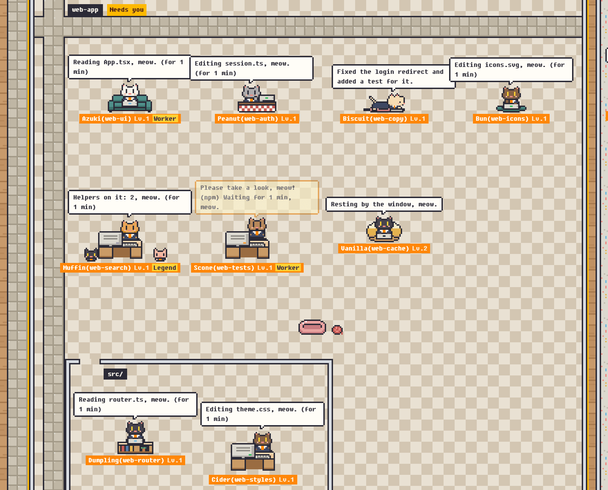
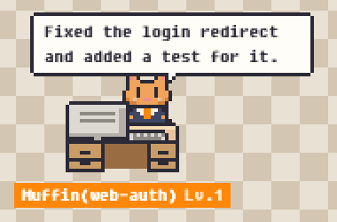
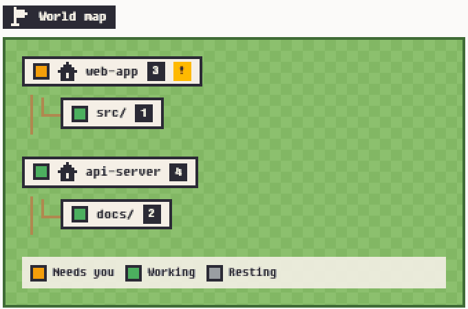
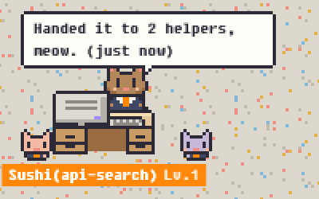
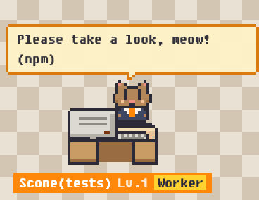
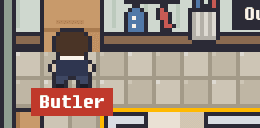
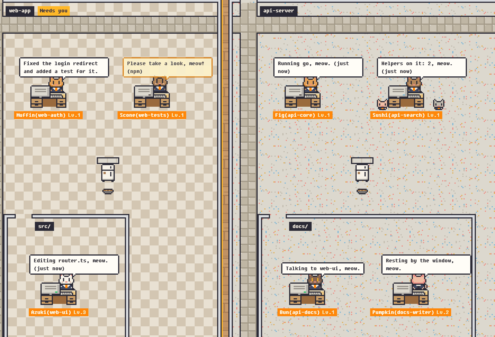
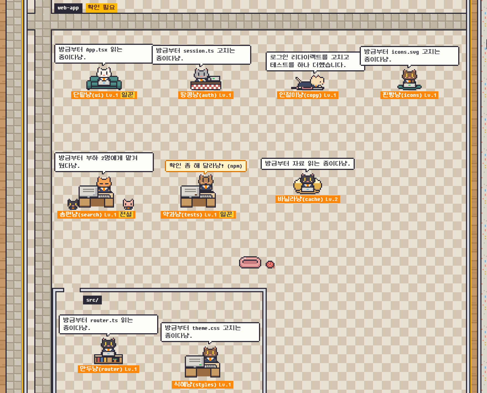
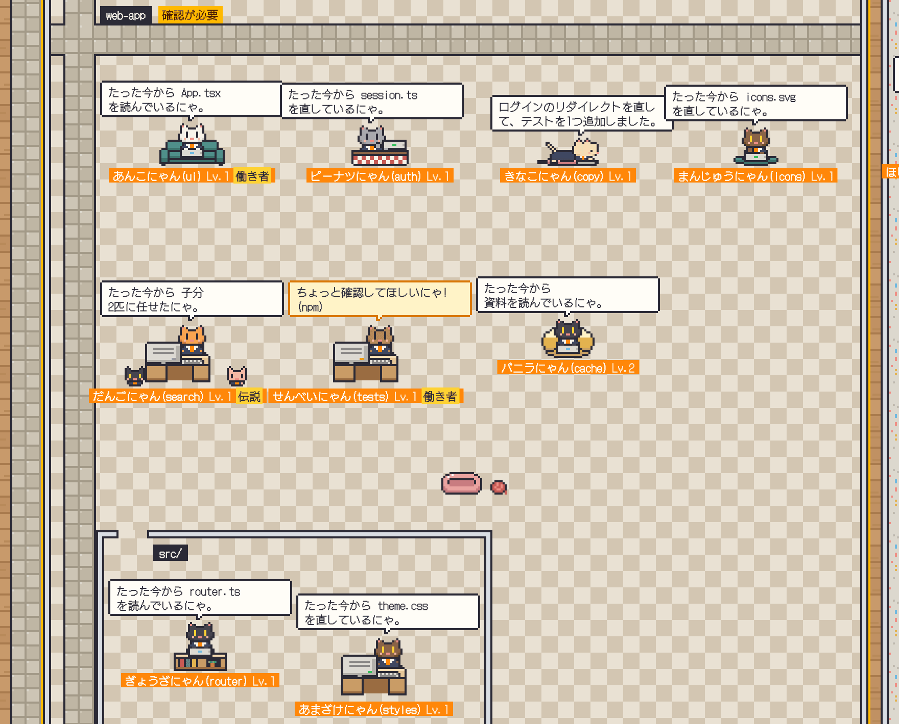

<p align="center">
  
</p>

<h1 align="center">kttn</h1>

<p align="center">Your Claude Code sessions as pixel cats in an office on your computer.</p>

<p align="center">
  <a href="https://github.com/hgwk/kttn/releases"></a>
  <a href="https://www.npmjs.com/package/@hgwk/kttn"></a>
  <a href="LICENSE"></a>
  
</p>

<p align="center"><b>English</b> · <a href="README.ko.md">한국어</a> · <a href="README.ja.md">日本語</a></p>

<p align="center">
  
  <br><sub><a href="https://raw.githubusercontent.com/hgwk/kttn/main/docs/images/full-en.png">Full view</a></sub>
</p>

```sh
npx @hgwk/kttn
```

One command: name your office, hook Claude Code, start at login, open it in the browser.

kttn shows the Claude Code sessions running on your computer as pixel cats in an
office. Each repository gets an office, each folder a room, each session a cat at
a desk. A cat reads, edits, runs commands, waits for you, naps and goes home as
its session does. Everything stays on your computer: a Claude Code hook sends
short labels to a small server on `127.0.0.1`, and the screen is a page that
server serves. The screen speaks English, Korean and Japanese.

## Features

| | |
| --- | --- |
|  | **One cat per session.** It reads, edits, runs commands, thinks, naps after a quiet spell and goes home when the session ends. With answer preview on, a finished cat says what it did. |
|  | **Offices are repositories, rooms are folders.** The world map lists them with how many cats are in each; click a spot to jump to that room. |
|  | **Kittens are subagents.** They stand by the desk until they finish, background ones included. |
|  | **Needs you.** A cat waiting on a permission prompt blinks, and its room and office light up so you see it from anywhere. |
|  | **The butler.** Click a cat and the butler walks over and brings its terminal tab to the front; click a speech bubble to type a message into that session. |
| 🔒 | **Short labels only.** Prompts, file contents, command arguments and error texts never leave the session. See [what leaves a session](#what-leaves-a-session). |

## How it looks

<p align="center">
  
</p>

<p align="center">
  
  
</p>

## Quick start

```sh
npx @hgwk/kttn
```

That one command asks for an office name and a language, hooks Claude Code,
starts the office at login (a LaunchAgent on macOS, a systemd user service on
Linux) and opens it in your browser. Run it again any time: it keeps your
settings and refreshes the hooks and the login service. `kttn uninstall`
takes the hooks and the login service out again.

kttn runs on macOS and Linux (arm64 and x86-64). **Windows is not supported.**

## What leaves a session

The hook sends one small event per hook call, and only these fields:

- the session ID, the repository name, the folder inside it, and where the
  repository sits relative to your home folder (`~` instead of your account name)
- the hook event and tool name
- one short label: a file's base name, a command's first program (`go`, `npm`),
  a web host, a subagent type, an MCP server name, or the name of the session a
  message goes to
- for a few events, a one-word reason: `startup`, `rate_limit`, `auto`, a model
  name; an error is one of a fixed set of kinds, never its text
- on `SessionStart`, `UserPromptSubmit`, `Stop` and `Notification` (never on
  tool events), the Claude Code process ID and the session's name, so a closed
  terminal can be noticed and an open one keeps its desk

It never sends prompts, file contents, command arguments, error texts or message
bodies.

**Answer preview (off by default).** If you turn it on in `kttn init`, `Stop`
also carries the first 300 characters of the answer the session just finished,
so the cat can say what it did, and task titles are sent for the desk checklist. The server keeps only the latest one per
session, in memory and in its local state file.

## Install

To install it yourself instead, pick one:

- **npm** (puts `kttn` on your PATH; downloads the binary for your platform
  from GitHub Releases and checks its SHA-256):

  ```sh
  npm i -g @hgwk/kttn
  ```

  Newer npm may warn that `@hgwk/kttn` has an install script it did not run.
  That is fine: kttn downloads its binary the first time it runs. To fetch it
  during the install instead, add `--allow-scripts=@hgwk/kttn`.

  Setup copies the binary to `~/.local/bin/kttn` so the hooks and the login
  service survive npm updates; after `npm update -g @hgwk/kttn`, run `kttn`
  again to move to the new version.

- **GitHub Releases**: download `kttn_<version>_<os>_<arch>.tar.gz` from
  https://github.com/hgwk/kttn/releases, check it against `SHA256SUMS`, and put
  `kttn` in a folder on your PATH.

- **From source** (Go 1.22+, Node 22.12+):

  ```sh
  git clone https://github.com/hgwk/kttn && cd kttn
  npm --prefix web ci && npm --prefix web run build   # the screen, embedded into the binary
  go build -o ~/.local/bin/kttn ./cmd/kttn             # any folder on your PATH
  ```

Then run `kttn` (the same setup as the quick start), or do it by hand:

```sh
kttn init    # office name, language, port, answer preview; writes ~/.config/kttn/config.json
kttn serve   # http://127.0.0.1:5886
```

Open the address in Chrome. You can install it as an app (⊕ in the address
bar) to get its own window and Dock icon.

### Connect Claude Code

The hook runs `kttn hook`, so install kttn first (above): `kttn` must be on the
`PATH` Claude Code sees. Then use **one** of these, not both, or every event is
reported twice:

- **The plugin**, which registers the hook for the 24 events it uses:

  ```text
  /plugin marketplace add hgwk/kttn
  /plugin install kttn@kttn
  ```

- **`kttn install`**, which adds the same hooks to `~/.claude/settings.json`
  (or `$CLAUDE_CONFIG_DIR/settings.json`), next to any hooks you already have,
  and keeps the previous file as `settings.json.bak`. `kttn uninstall` takes
  them out again and leaves everything else as it was.

If the server is not running, the hook gives up after 300 ms and the session
carries on; it never prints anything and never blocks a session.

Neither hooks `WorktreeCreate`, because a hook there replaces Claude Code's own
worktree creation.

## Commands

| Command | What it does |
| --- | --- |
| `kttn` or `kttn setup` | One-command setup: office name and language on the first run, Claude Code hooks, start at login, open the office. |
| `kttn init [--yes] [--office-name NAME] [--lang ko\|en\|ja] [--port N] [--preview]` | Asks for the settings (or takes flags with `--yes`), keeps earlier answers as defaults, picks another port if the one you want is taken by something else, and generates the token the hook and the server share. |
| `kttn serve [--port N]` | Runs the office on `127.0.0.1`. |
| `kttn hook [--url URL] [--source claude] [--timeout 300ms]` | The Claude Code hook. Reads a hook payload on stdin. |
| `kttn install` | Adds the hook to Claude Code's user settings, for use without the plugin. |
| `kttn uninstall` | Removes the hook and stops starting the office at login. The config and session state stay. |
| `kttn open` | Opens the office in the browser with your screen key. |
| `kttn version` | Prints the version. |

Config lives in `~/.config/kttn/config.json` (mode 600; `KTTN_CONFIG` moves
it). `KTTN_URL` and `KTTN_TOKEN` override the hook's address and token.
Sessions survive a restart through `~/.local/state/kttn/sessions.json`
(`KTTN_STATE` moves it).

The screen language follows `?lang=` in the address, then the config, then the
browser, and falls back to English.

## Terminal tabs

Click a cat and the butler walks over and brings that session's terminal tab to
the front. Click its speech bubble to type a message into the session's input;
Enter is pressed for you.

kttn finds the tab from the session's process: process → tty → the terminal
pane on that tty. It tries, in order:

| Terminal | Bring forward | Message |
| --- | --- | --- |
| tmux | selects the window and pane (not the app around it) | `send-keys` |
| Kaku, WezTerm | `cli activate-pane`, then raises the app | `cli send-text` |
| iTerm2 | AppleScript, by the session's `tty` | AppleScript `write text` |
| Terminal.app | AppleScript, by the tab's `tty` | not supported (needs accessibility permission) |

A terminal that is not installed or not running is skipped; one that is not
running is never launched. AppleScript asks for automation permission the first
time. For tmux, `tmux` must be on the `PATH` of `kttn serve`.

Messages are limited to 2,000 characters, control characters are removed, and
nothing is sent to a session that is waiting on a permission prompt (the text
would answer it) or has ended. A busy session takes the message as its next
turn. Message text is never logged.

## Safety

The server listens on `127.0.0.1` only and refuses any request addressed to a
host name other than `127.0.0.1` or `localhost`, which blocks DNS rebinding.
Hook reports (`/api/events`) must be JSON, must carry the token,
and must not carry an `Origin` header, so a web page in your browser cannot forge
sessions. Screen actions (`/api/focus`, `/api/message`) must be JSON from a page
on the same address, so another site cannot type into your terminal.

The sessions and the terminal actions also need a **screen key**, a random
value kept in your config (mode 600). Origin and Host checks stop other web
sites, but not other programs or other users on the same computer; the key
does. `kttn` and `kttn open` open the office at `/#k=<key>`; the page keeps the
key in the browser and drops it from the address. A page without it gets 401
and asks you to run `kttn open`.

Only the office itself and the pages listed in `embed_origins` in the config
may show the office in an iframe (`frame-ancestors`). The list is empty by default. A page that embeds the office passes the key the
same way, in the iframe address: `http://127.0.0.1:5886/#k=<screen_key>`.

## Development

```sh
go vet ./... && go test ./...
npm --prefix web test && npm --prefix web run typecheck
npm --prefix web run dev    # screen with hot reload, proxying /api to kttn serve
```

Source files stay at or below 300 lines.

## Not yet

- Messaging through Claude Code Channels instead of the terminal. Channels is a
  research preview that loads custom channels only with a development flag, so
  kttn types into the terminal for now.
- Codex sessions. A Codex hook that posts the same event shape would show up in
  the office with `--source codex`.

## Licenses

kttn is MIT licensed ([LICENSE](LICENSE)). The fonts it ships are listed in
[THIRD_PARTY_NOTICES.md](THIRD_PARTY_NOTICES.md); the pixel art is original.
